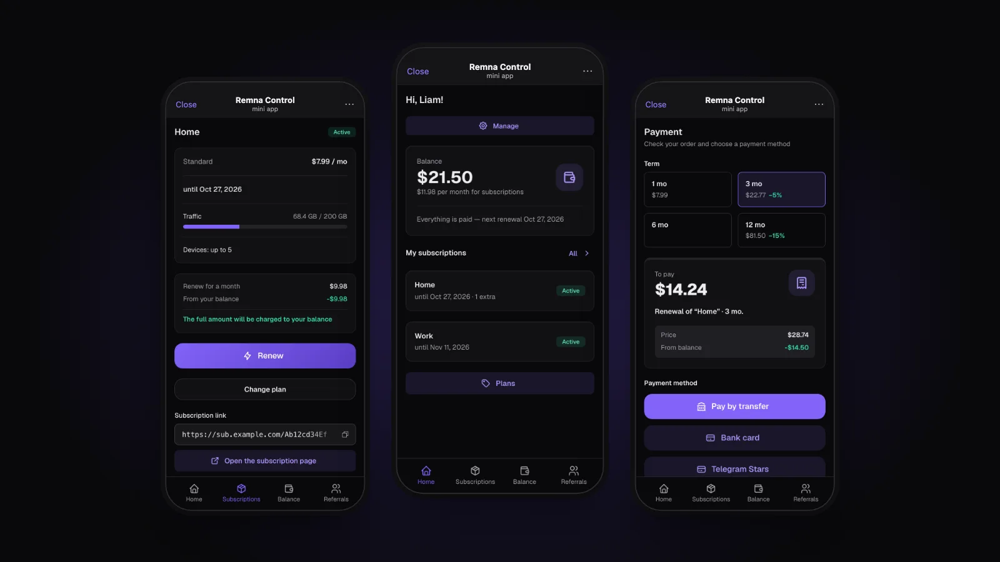
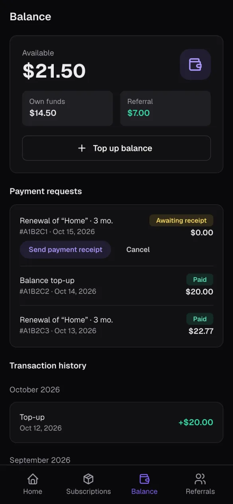
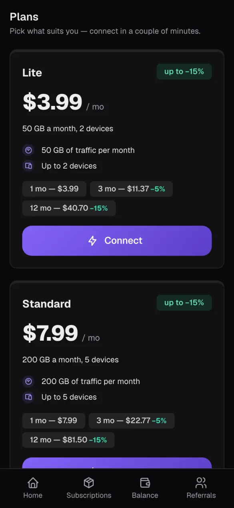
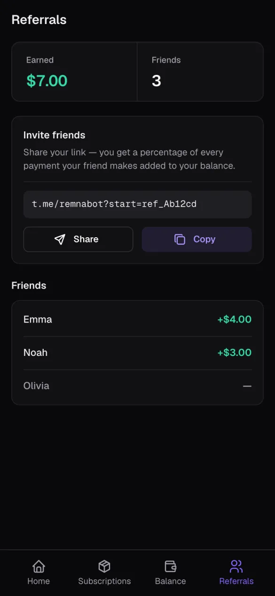
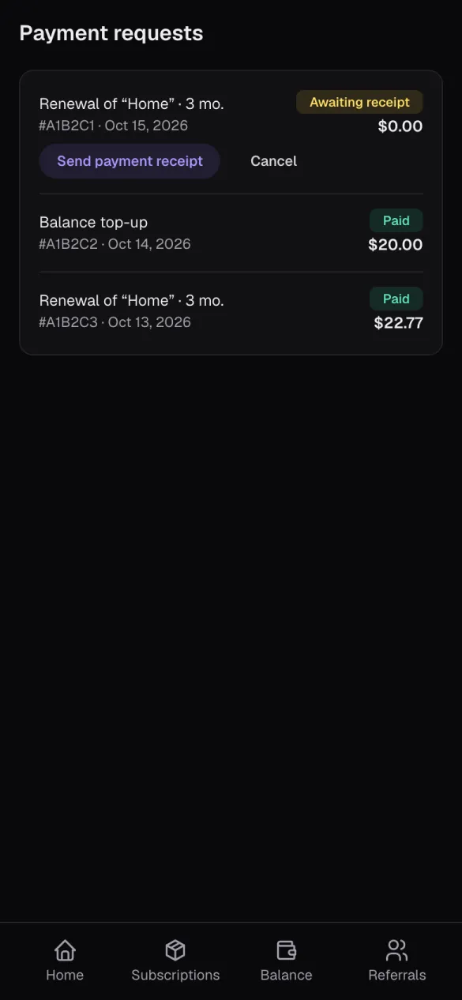
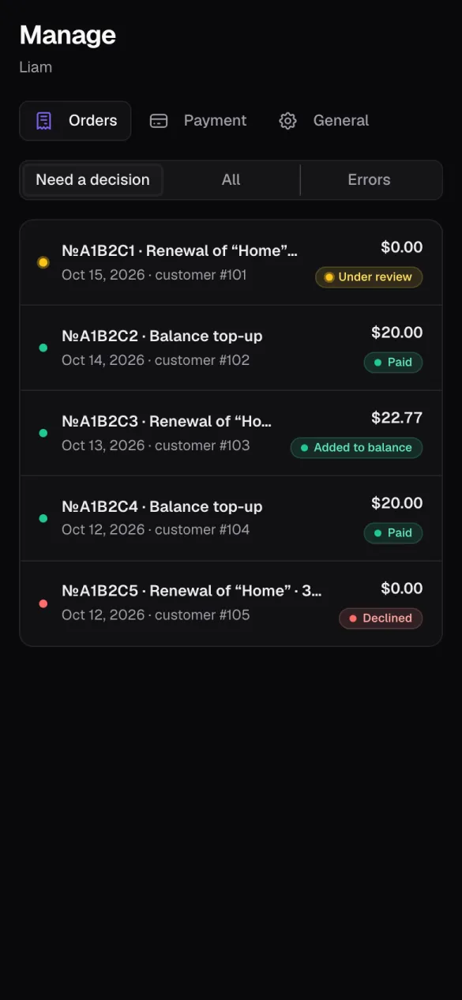
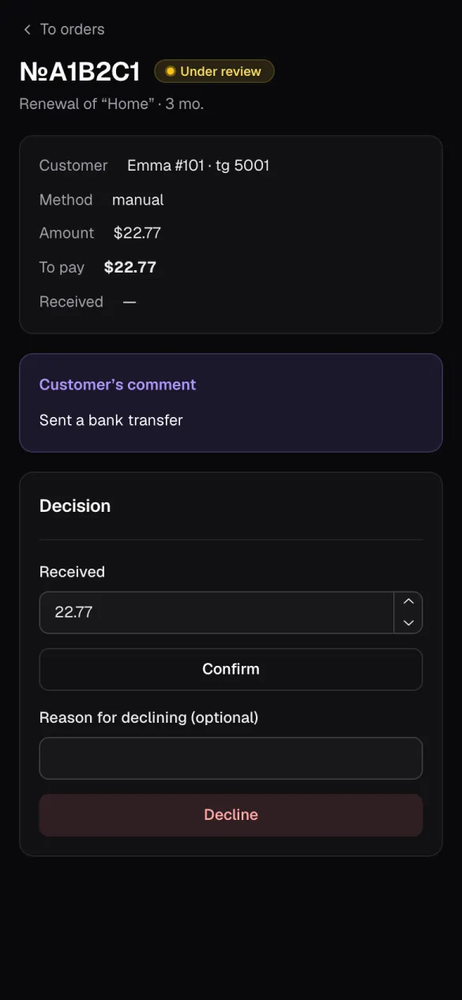

<div align="center">


# Remna Control Bot

**A Telegram bot and Mini App for the customers of [Remna Control](https://github.com/lentryd/remna-control)**

Subscriptions and add-ons, balance and history, referrals, tariffs and payments (Telegram Stars, YooKassa, CryptoBot, Heleket, PayPalych, Platega or a manual transfer), all inside Telegram.

[](go.mod)
[](web/package.json)
[](web/package.json)
[](internal/store)
[](LICENSE)
[](https://github.com/lentryd/remna-control-bot/releases)
[](https://github.com/lentryd/remna-control-bot/actions/workflows/test.yaml)

**English** · [Русский](README.ru.md)



</div>

## Why

Customers of a VPN service shouldn't have to write to support to learn when their subscription ends or to pay for it. The bot is a launcher: its menu opens the Mini App on the right page, where customers see their subscriptions, top up the balance, renew, change tariffs and invite friends. What stays in the chat is onboarding (`/start` and sending a subscription link), receipts for manual payments, Telegram Stars invoices, notifications and the order cards for admins.

It is one Go process: the bot (long polling) and an HTTP server for the Mini App. All customer data comes from the Remna Control API, and the bot's own SQLite keeps only orders, settings and who is expected to send a link.

## Features

- **Subscriptions and add-ons.** Status, term, traffic and devices from the panel, with the subscription link and its page.
- **Renewal and tariff changes** for any term the tariff offers, with the balance applied first.
- **Balance and history.** Top-ups and charges. Every payment is applied exactly once.
- **Payments.** Telegram Stars, YooKassa, CryptoBot, Heleket, PayPalych, Platega, a manual transfer with a receipt, and the balance. See [Payment providers](#payment-providers).
- **Referrals.** A personal invite link and what each friend has brought in.
- **Notifications.** Traffic alerts and payment reminders before the end of a term.
- **Admin app.** Orders, payment methods and settings, edited in the Mini App without a restart. Orders that need a decision come to admins as cards in the chat. See [Admin](#admin).
- **Bot profile out of the box.** On the first start the bot fills in its name, descriptions, commands, menu button and photo; `/init` does it again.
- **English and Russian,** following the Telegram language.

## Screenshots

<table>
  <tr>
    <td width="33%"><br><sub><b>Balance:</b> own and referral funds, payment requests and history</sub></td>
    <td width="33%"><br><sub><b>Plans:</b> limits and term discounts</sub></td>
    <td width="33%"><br><sub><b>Referrals:</b> the invite link and friends' rewards</sub></td>
  </tr>
  <tr>
    <td><br><sub><b>Payment requests:</b> what is waiting for a receipt and what is paid</sub></td>
    <td><br><sub><b>Admin:</b> orders that need a decision</sub></td>
    <td><br><sub><b>Admin:</b> checking a receipt and approving the payment</sub></td>
  </tr>
</table>

<sub>The screenshots show made-up demo data.</sub>

## Quick start

You need [Remna Control](https://github.com/lentryd/remna-control) running next to a Remnawave panel, and Docker. The bot runs as one more container in the same docker network and is served on Remna Control's domain under `/bot`. A ready image is published at `ghcr.io/lentryd/remna-control-bot` for `linux/amd64` and `linux/arm64`, so you don't need to clone or build anything.

1. Create a bot with [@BotFather](https://t.me/BotFather) and copy its token.
2. In Remna Control, create an API token in **Settings → API tokens** with the **Telegram bot** preset.
3. On the server, make a folder and download the example [`compose.yml`](compose.yml) and [`.env.example`](.env.example) into it:

   ```bash
   mkdir remna-control-bot && cd remna-control-bot
   curl -fsSL -o compose.yml https://raw.githubusercontent.com/lentryd/remna-control-bot/main/compose.yml
   curl -fsSL -o .env https://raw.githubusercontent.com/lentryd/remna-control-bot/main/.env.example
   ```

4. Fill in `.env`:
   - `BOT_TOKEN` and `REMNACTL_TOKEN` from the first two steps;
   - `APP_DOMAIN`: Remna Control's domain, and `PUBLIC_URL=https://<APP_DOMAIN>`;
   - `REF_SECRET`: `openssl rand -hex 32`;
   - `ADMIN_IDS`: your Telegram id ([@userinfobot](https://t.me/userinfobot) shows it), several separated by commas.

   Check `REMNACTL_URL` (Remna Control's container name), `REMNAWAVE_NETWORK`, `TRAEFIK_CERTRESOLVER` and `TRAEFIK_ENTRYPOINTS` against your setup.
5. Start it:

   ```bash
   docker compose up -d
   ```

6. Open the bot in Telegram and press **Start**. On the first start it sets its own name, description, commands, menu button and photo. Send `/admin` to open the admin app: turn on payment methods and choose who can use the bot (see [Access modes](#access-modes)).

`compose.yml` is only an example. Change it to fit your server, or add the service to Remna Control's compose file.

### Updating

```bash
docker compose pull && docker compose up -d
```

The data lives in the `bot-data` volume and survives updates. To pin a version, use a release tag instead of `latest`, for example `image: ghcr.io/lentryd/remna-control-bot:0.1.0`. Releases are listed on the [Releases](https://github.com/lentryd/remna-control-bot/releases) page.

### Deployment notes

- The Traefik labels route `Host(APP_DOMAIN)` with `PathPrefix(WEBAPP_PATH)` (the Mini App) or `PathPrefix(/pay/)` (payment webhooks) to the bot, with a higher priority than Remna Control's router on the same domain.
- **Without Traefik:** the bot listens on port 8090. Route `WEBAPP_PATH` and `/pay/` to it in your reverse proxy and drop the `labels`. `PUBLIC_URL` must be https and reachable from the internet, because Telegram opens the Mini App there and payment services send webhooks there.
- The bot needs no webhook from Telegram: it uses long polling, so only outgoing access to `api.telegram.org` is required.

## Configuration

Environment variables hold only what the process needs to start. Everything else (bot mode, payment methods and their keys, notifications) is set in the admin app and stored in the bot's SQLite.

| Variable | Required | Default | Purpose |
|---|---|---|---|
| `BOT_TOKEN` | yes | | Telegram bot token |
| `REMNACTL_URL` | yes | | Remna Control base URL, e.g. `http://vpn-control:8080` |
| `REMNACTL_TOKEN` | yes | | Remna Control API token (see below) |
| `PUBLIC_URL` | yes | | public origin, e.g. `https://control.example.com`; payment webhooks go to `PUBLIC_URL/pay/<provider>`, so it must be https and reachable |
| `WEBAPP_PATH` | no | `/bot` | Mini App path; its URL is `PUBLIC_URL + WEBAPP_PATH` |
| `REF_SECRET` | yes | | referral code secret; also the source of the key that encrypts stored payment keys. Changing it invalidates every issued link, and the keys must be entered again |
| `ADMIN_IDS` | yes | | comma-separated Telegram ids of the admins (e.g. `12345,67890`) |
| `HTTP_ADDR` | no | `:8090` | listen address |
| `DB_PATH` | no | `/data/bot.db` | the bot's SQLite (orders, settings, link expectations) |
| `LOG_LEVEL` | no | `info` | `debug` / `info` / `warn` / `error` |

`APP_DOMAIN`, `REMNAWAVE_NETWORK`, `TRAEFIK_ENTRYPOINTS` and `TRAEFIK_CERTRESOLVER` are used only by `compose.yml`.

**Remna Control token:** **Settings → API tokens → Telegram bot** preset (`customers:lookup`, `customers:get`, `customers:create`, `customers:update`, `customers:list`, `subscriptions:list`, `tariffs:list`, the payment scopes and `stats:settings`, which gives the base currency). A token issued before the preset gained the payment scopes and `stats:settings` must be re-issued; until then the bot uses the base currency set in the admin app, if any.

## Access modes

The mode is set in the admin app (see [Admin](#admin)); the default is `closed`.

- `open`: anyone can start the bot, and a new user becomes a Remna Control customer.
- `closed`: only customers whose `telegram_id` is set in the panel, users who send the link to their subscription (the bot links their Telegram id), and users who come via a referral link.

Referral links look like `https://t.me/<bot>?start=ref_<code>`. The code is derived from the customer id and `REF_SECRET`, so nothing is stored.

## Admin

Admins are the Telegram ids in `ADMIN_IDS`. Admin rights are checked on every request.

- **First start:** every payment method is off, and the general settings have defaults: mode `closed`, balance payments `mixed`, a notification check every 60 minutes, a traffic alert at 80%, payment reminders 3 and 1 days before the end, unpaid orders expire after 48 hours, and the base currency comes from the panel. If no method is enabled at startup, admins get a one-time message saying so.
- **Bot profile:** on the first start, if the bot has no description yet, it fills in its own name, descriptions (with a link to this repository), commands, menu button and photo. `/init` does the same again on demand, overwriting what was set in @BotFather, and replies with what failed, if anything. `/admin` and `/init` are shown only in admins' command menus.
- **Opening the admin app:** send `/admin` to the bot, or press the button on an order card. It has screens for orders, payment methods and general settings.
- **Payment methods:** enable a method, enter its keys and save. The webhook URL to register with the payment service is shown next to it, and **Check** tests the keys where the service supports it (CryptoBot, YooKassa). Changes apply immediately; a method that is switched off still finishes the invoices it already issued.
- **General settings:** bot mode, balance payment mode, base currency fallback, notification interval (`0` turns notifications off), traffic alert percentage, reminder days, order lifetime.
- **Keys are encrypted** in the bot's database with a key derived from `REF_SECRET`. If `REF_SECRET` changes, the stored keys can no longer be read (the bot logs a warning at startup) and must be entered again.
- **Order cards:** orders that need a decision (a receipt to check, a payment with a wrong amount) come to every admin as a private message with a button that opens the order. Each admin must press **Start** in the bot once, otherwise Telegram doesn't let the bot write to them (the Orders screen shows who is unreachable). Approve or reject in the app; the cards in all admin chats are updated with the decision.

## Payment providers

Customers can pay with **Telegram Stars**, **YooKassa** (cards, SBP), **CryptoBot** and **Heleket** (crypto), **PayPalych** and **Platega**, next to a manual transfer and the balance. A provider appears at checkout once an admin has enabled it and entered its keys. Payments are confirmed automatically and applied exactly once. A payment that arrives for an expired or cancelled order is still applied, and a wrong amount goes to the admins as a card.

Invoices are issued in the panel's base currency. A provider that doesn't support that currency rejects the invoice, and the customer sees "could not create an invoice". Stars are converted at the rate set in the admin app (base-currency units per Star).

Provider invoices need a confirmed base currency: either the panel reports it (a token with `stats:settings`) or it is set in the general settings. Otherwise the bot logs an error and provider payments stay off; the manual transfer and the balance still work.

**Webhooks.** The bot serves `POST {PUBLIC_URL}/pay/yookassa`, `/pay/cryptobot`, `/pay/heleket`, `/pay/pal24` and `/pay/platega` (not under `WEBAPP_PATH`). Route `/pay/*` to the bot and register the URL with the payment service (it is shown next to each method in the admin app):

- **YooKassa:** HTTP notifications for `payment.succeeded`.
- **CryptoBot:** Crypto Pay → My Apps → Webhooks.
- **Heleket:** nothing to set; the bot passes the callback URL with every invoice.
- **PayPalych:** `{PUBLIC_URL}/pay/pal24` as the **Result URL**. Its postback signature doesn't cover the status, so every confirmation is checked against the bill (`bill/status`); a postback without `bill_id` is ignored, and the background check confirms the payment within about a minute.
- **Platega:** `{PUBLIC_URL}/pay/platega` as the **callback URL** in the merchant settings; it authenticates with the `X-MerchantId`/`X-Secret` headers.
- **Telegram Stars** need no webhook.

If a webhook is lost, the bot asks the payment service about waiting invoices every minute.

**Smoke test** (in each service's test mode): YooKassa with a test shop and a test card, CryptoBot on the testnet with @CryptoTestnetBot, Heleket with a test-mode merchant, PayPalych and Platega with a small real bill, Stars from a test account. Create a top-up for the smallest amount and pay it. The order must become *Paid*, the panel must get a payment with the service's name as its method, and a repeated webhook must change nothing.

PayPalych and Platega are written from Bedolaga's reference and haven't been run against the live services yet.

## Languages

The bot and the Mini App speak English and Russian, following the Telegram language. See [docs/i18n.md](docs/i18n.md) for how to add one.

## Development

Requirements: Go 1.26, [Bun](https://bun.sh), [Task](https://taskfile.dev) and Docker; [golangci-lint](https://golangci-lint.run) for `task lint`.

```bash
task init       # .env, frontend dependencies, a copy of the local panel DB
task up         # local stack: traefik + panel + bot on https://LOCAL_DOMAIN
task dev        # panel in Docker, the bot on the host with hot reload
task test       # Go tests, frontend type check, locale check
task build      # binary with the embedded Mini App -> bin/bot
task lint       # go mod tidy, go fmt, go vet and golangci-lint
task docker     # local image remna-control-bot:local
```

The local stack expects Remna Control checked out next to this repository (`../vpn-control`):

1. `task init` creates `.env`, installs the frontend dependencies and copies `../vpn-control/data/vpn-control.db` into `dev/panel-data/` (git-ignored; `task panel:db` refreshes it, `PANEL_DB` overrides the source). Fill in `BOT_TOKEN`, `REF_SECRET`, `ADMIN_IDS` and `LOCAL_DOMAIN`, a subdomain of your own domain such as `local.example.com`. The panel container reads `../vpn-control/.env` (override with `PANEL_ENV`).
2. `task up` creates an mkcert certificate for `LOCAL_DOMAIN`, checks `/etc/hosts` (add `127.0.0.1 <LOCAL_DOMAIN>` if asked) and starts traefik, the panel and the bot: the panel at `https://<LOCAL_DOMAIN>/`, the Mini App at `https://<LOCAL_DOMAIN>/bot/`, the traefik dashboard at http://localhost:8088.
3. In the panel, create an API token with the **Telegram bot** preset, put it into `REMNACTL_TOKEN` and run `task up` again.
4. Telegram Desktop on the same machine trusts the mkcert CA and opens the Mini App from the menu button.

`task dev` keeps the panel and traefik in Docker and runs the bot on the host. Go changes rebuild and restart it ([air](https://github.com/air-verse/air)), and frontend changes rebuild `web/dist`, which the bot serves from disk, so reloading the Mini App is enough. `task dev:web:server` is a standalone browser dev server. `task logs` follows the bot, `task down` stops the stack.

- Stack: Go, [go-telegram/bot](https://github.com/go-telegram/bot), Fiber and SQLite without CGO ([modernc.org/sqlite](https://modernc.org/sqlite)); the Mini App is React 19, Mantine 9, react-router, TanStack Query and i18next, built with Bun and embedded in the binary.
- Bot texts live in `internal/i18n/locales`, Mini App texts in `web/public/locales`. See [docs/i18n.md](docs/i18n.md).

### Releases

CI ([`.github/workflows`](.github/workflows)) runs the frontend type check and build, `gofmt`, `go vet`, the tests, golangci-lint and a check of the release config on every push and pull request. Pushing a `v*` tag runs [GoReleaser](https://goreleaser.com) ([`.goreleaser.yaml`](.goreleaser.yaml)), which:

- builds the binaries for `linux/amd64` and `linux/arm64` with the embedded Mini App and attaches them to a GitHub release with checksums, a Sigstore signature and SBOMs;
- builds the image with [ko](https://ko.build) and pushes it to `ghcr.io/lentryd/remna-control-bot` as `<version>` and `latest`.

```bash
git tag v1.0.0 && git push origin v1.0.0
```

`task snapshot` builds the same artifacts locally without publishing them.

## License

[AGPL-3.0](LICENSE).

Remna Control Bot is an independent project and is not affiliated with the Remnawave team.
