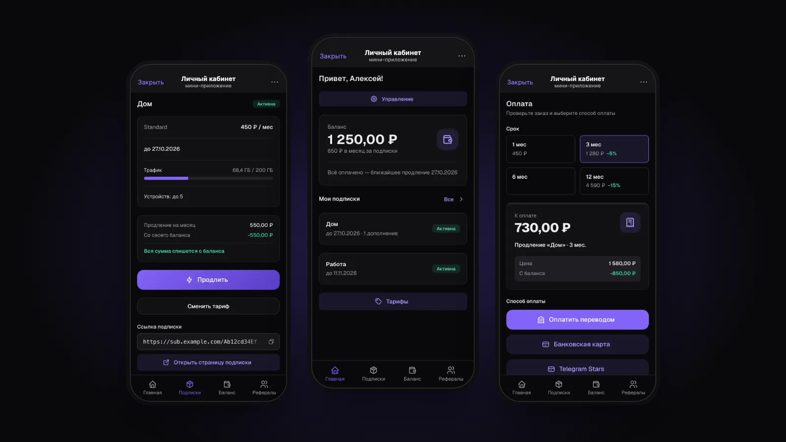
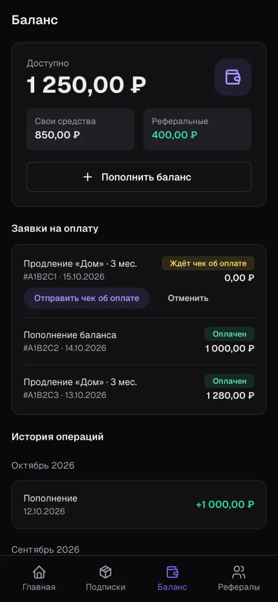
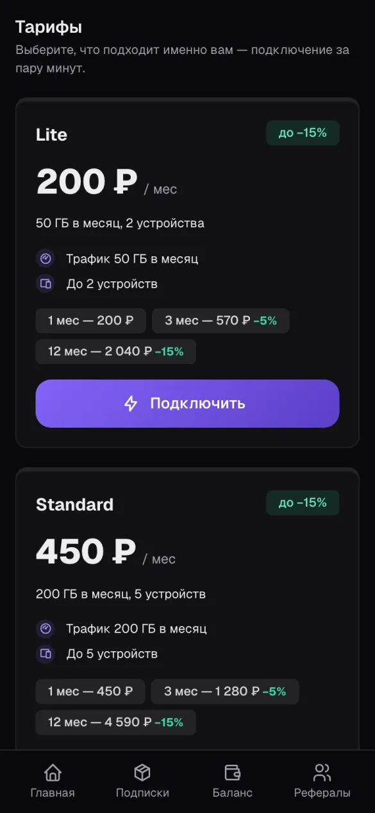
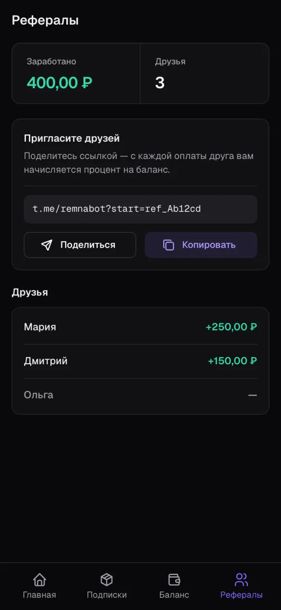
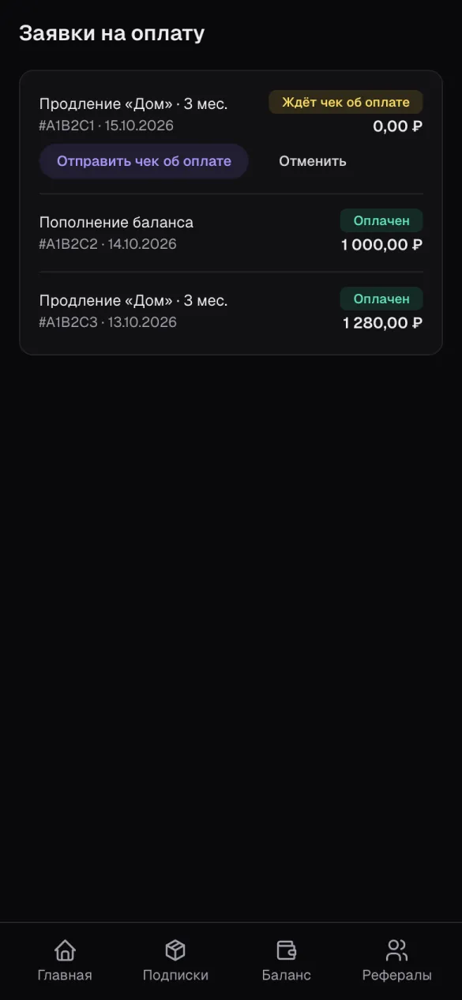
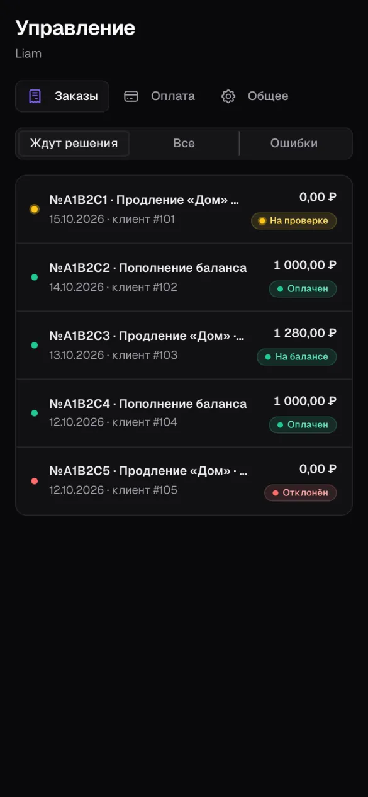
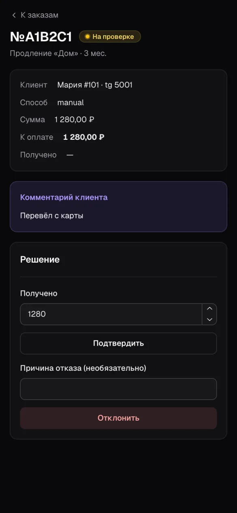

<div align="center">


# Remna Control Bot

**Telegram-бот и мини-приложение для клиентов [Remna Control](https://github.com/lentryd/remna-control)**

Подписки и дополнения, баланс и история, рефералы, тарифы и оплата (Telegram Stars, ЮKassa, CryptoBot, Heleket, PayPalych, Platega или ручной перевод) — прямо в Telegram.

[](go.mod)
[](web/package.json)
[](web/package.json)
[](internal/store)
[](LICENSE)
[](https://github.com/lentryd/remna-control-bot/releases)
[](https://github.com/lentryd/remna-control-bot/actions/workflows/test.yaml)

[English](README.md) · **Русский**



</div>

## Зачем

Клиентам VPN-сервиса не нужно писать в поддержку, чтобы узнать, когда заканчивается подписка, или чтобы её оплатить. Бот — это лаунчер: его меню открывает мини-приложение на нужной странице, где клиент видит свои подписки, пополняет баланс, продлевает, меняет тариф и приглашает друзей. В самом чате остаются онбординг (`/start` и отправка ссылки на подписку), чеки для ручных платежей, счета в Telegram Stars, уведомления и карточки заказов для админов.

Это один Go-процесс: бот (long polling) и HTTP-сервер для мини-приложения. Все данные клиентов приходят из API Remna Control, а собственная SQLite бота хранит только заказы, настройки и тех, от кого ждут ссылку.

## Возможности

- **Подписки и дополнения.** Статус, срок, трафик и устройства из панели, ссылка на подписку и её страница.
- **Продление и смена тарифа** на любой срок, который есть у тарифа; сначала списывается баланс.
- **Баланс и история.** Пополнения и списания. Каждый платёж зачисляется ровно один раз.
- **Оплата.** Telegram Stars, ЮKassa, CryptoBot, Heleket, PayPalych, Platega, ручной перевод с чеком и баланс. См. [Платёжные сервисы](#платёжные-сервисы).
- **Рефералы.** Личная ссылка-приглашение и сколько принёс каждый друг.
- **Уведомления.** Предупреждения о трафике и напоминания об оплате до конца срока.
- **Управление.** Заказы, способы оплаты и настройки меняются в мини-приложении без перезапуска. Заказы, которые ждут решения, приходят админам карточками в чат. См. [Управление](#управление).
- **Профиль бота из коробки.** При первом запуске бот сам заполняет название, описания, команды, кнопку меню и фото; `/init` делает это повторно.
- **Английский и русский** — по языку Telegram.

## Скриншоты

<table>
  <tr>
    <td width="33%"><br><sub><b>Баланс:</b> свои и реферальные средства, заявки на оплату и история</sub></td>
    <td width="33%"><br><sub><b>Тарифы:</b> лимиты и скидки за срок</sub></td>
    <td width="33%"><br><sub><b>Рефералы:</b> ссылка-приглашение и начисления за друзей</sub></td>
  </tr>
  <tr>
    <td><br><sub><b>Заявки на оплату:</b> что ждёт чек и что уже оплачено</sub></td>
    <td><br><sub><b>Управление:</b> заказы, которые ждут решения</sub></td>
    <td><br><sub><b>Управление:</b> проверка чека и подтверждение оплаты</sub></td>
  </tr>
</table>

<sub>На скриншотах вымышленные демо-данные.</sub>

## Быстрый старт

Нужны [Remna Control](https://github.com/lentryd/remna-control), запущенный рядом с панелью Remnawave, и Docker. Бот работает ещё одним контейнером в той же docker-сети и открывается на домене Remna Control по пути `/bot`. Готовый образ публикуется в `ghcr.io/lentryd/remna-control-bot` для `linux/amd64` и `linux/arm64`, поэтому клонировать и собирать ничего не нужно.

1. Создайте бота в [@BotFather](https://t.me/BotFather) и скопируйте его токен.
2. В Remna Control создайте API-токен в **Настройки → API-токены** с пресетом **Telegram bot**.
3. На сервере создайте папку и скачайте в неё пример [`compose.yml`](compose.yml) и [`.env.example`](.env.example):

   ```bash
   mkdir remna-control-bot && cd remna-control-bot
   curl -fsSL -o compose.yml https://raw.githubusercontent.com/lentryd/remna-control-bot/main/compose.yml
   curl -fsSL -o .env https://raw.githubusercontent.com/lentryd/remna-control-bot/main/.env.example
   ```

4. Заполните `.env`:
   - `BOT_TOKEN` и `REMNACTL_TOKEN` из первых двух шагов;
   - `APP_DOMAIN` — домен Remna Control, и `PUBLIC_URL=https://<APP_DOMAIN>`;
   - `REF_SECRET` — `openssl rand -hex 32`;
   - `ADMIN_IDS` — ваш Telegram id (его покажет [@userinfobot](https://t.me/userinfobot)), несколько — через запятую.

   Сверьте `REMNACTL_URL` (имя контейнера Remna Control), `REMNAWAVE_NETWORK`, `TRAEFIK_CERTRESOLVER` и `TRAEFIK_ENTRYPOINTS` со своими настройками.
5. Запустите:

   ```bash
   docker compose up -d
   ```

6. Откройте бота в Telegram и нажмите **Старт**. При первом запуске он сам выставит себе название, описание, команды, кнопку меню и фото. Отправьте `/admin`, чтобы открыть управление: включите способы оплаты и выберите, кто может пользоваться ботом (см. [Режимы доступа](#режимы-доступа)).

`compose.yml` — только пример. Подстройте его под свой сервер или добавьте сервис в compose-файл Remna Control.

### Обновление

```bash
docker compose pull && docker compose up -d
```

Данные хранятся в volume `bot-data` и переживают обновления. Чтобы зафиксировать версию, укажите вместо `latest` тег релиза, например `image: ghcr.io/lentryd/remna-control-bot:0.1.0`. Список версий — на странице [Releases](https://github.com/lentryd/remna-control-bot/releases).

### Детали развёртывания

- Лейблы Traefik направляют в бота `Host(APP_DOMAIN)` с `PathPrefix(WEBAPP_PATH)` (мини-приложение) или `PathPrefix(/pay/)` (вебхуки оплаты) — с приоритетом выше, чем у роутера Remna Control на том же домене.
- **Без Traefik:** бот слушает порт 8090. Направьте на него `WEBAPP_PATH` и `/pay/` в своём реверс-прокси и уберите `labels`. `PUBLIC_URL` должен быть https и доступен из интернета: по нему Telegram открывает мини-приложение, а платёжные сервисы шлют вебхуки.
- Вебхук от Telegram боту не нужен: он работает через long polling, нужен только исходящий доступ к `api.telegram.org`.

## Настройка

В переменных окружения — только то, что нужно для запуска. Всё остальное (режим бота, способы оплаты и их ключи, уведомления) задаётся в управлении и хранится в SQLite бота.

| Переменная | Обязательна | По умолчанию | Назначение |
|---|---|---|---|
| `BOT_TOKEN` | да | | токен Telegram-бота |
| `REMNACTL_URL` | да | | базовый URL Remna Control, например `http://vpn-control:8080` |
| `REMNACTL_TOKEN` | да | | API-токен Remna Control (см. ниже) |
| `PUBLIC_URL` | да | | публичный адрес, например `https://control.example.com`; вебхуки оплаты приходят на `PUBLIC_URL/pay/<сервис>`, поэтому нужен https и доступ извне |
| `WEBAPP_PATH` | нет | `/bot` | путь мини-приложения; его адрес — `PUBLIC_URL + WEBAPP_PATH` |
| `REF_SECRET` | да | | секрет реферальных кодов; из него же выводится ключ шифрования сохранённых ключей оплаты. Смена делает недействительными все выданные ссылки, а ключи придётся ввести заново |
| `ADMIN_IDS` | да | | Telegram id админов через запятую (например `12345,67890`) |
| `HTTP_ADDR` | нет | `:8090` | адрес, который слушает сервер |
| `DB_PATH` | нет | `/data/bot.db` | SQLite бота (заказы, настройки, ожидание ссылок) |
| `LOG_LEVEL` | нет | `info` | `debug` / `info` / `warn` / `error` |

`APP_DOMAIN`, `REMNAWAVE_NETWORK`, `TRAEFIK_ENTRYPOINTS` и `TRAEFIK_CERTRESOLVER` использует только `compose.yml`.

**Токен Remna Control:** **Настройки → API-токены → пресет Telegram bot** (`customers:lookup`, `customers:get`, `customers:create`, `customers:update`, `customers:list`, `subscriptions:list`, `tariffs:list`, платёжные права и `stats:settings`, из которого берётся базовая валюта). Токен, выпущенный до того, как в пресет добавили платёжные права и `stats:settings`, нужно перевыпустить; до этого бот берёт базовую валюту из управления, если она там задана.

## Режимы доступа

Режим задаётся в управлении (см. [Управление](#управление)); по умолчанию — `closed`.

- `open` — бота может запустить кто угодно, новый пользователь становится клиентом Remna Control.
- `closed` — только клиенты, у которых в панели указан `telegram_id`, пользователи, приславшие ссылку на свою подписку (бот привязывает их Telegram id), и те, кто пришёл по реферальной ссылке.

Реферальные ссылки выглядят как `https://t.me/<бот>?start=ref_<код>`. Код вычисляется из id клиента и `REF_SECRET`, поэтому ничего не хранится.

## Управление

Админы — это Telegram id из `ADMIN_IDS`. Права проверяются при каждом запросе.

- **Первый запуск:** все способы оплаты выключены, у общих настроек значения по умолчанию: режим `closed`, оплата с баланса `mixed`, проверка уведомлений раз в 60 минут, предупреждение о трафике при 80%, напоминания об оплате за 3 и 1 день до конца, неоплаченные заказы истекают через 48 часов, базовая валюта берётся из панели. Если при старте не включён ни один способ, админы получают одно сообщение об этом.
- **Профиль бота:** при первом запуске, если у бота ещё нет описания, он сам заполняет название, описания (со ссылкой на этот репозиторий), команды, кнопку меню и фото. `/init` делает то же самое по запросу, перезаписывая то, что задано в @BotFather, и отвечает, какие шаги не удались. `/admin` и `/init` видны только в меню команд админов.
- **Как открыть:** отправьте боту `/admin` или нажмите кнопку на карточке заказа. Там есть экраны заказов, способов оплаты и общих настроек.
- **Способы оплаты:** включите способ, введите ключи и сохраните. Рядом показан URL вебхука, который нужно указать в платёжном сервисе, а кнопка **Проверить** проверяет ключи там, где сервис это поддерживает (CryptoBot, ЮKassa). Изменения применяются сразу; выключенный способ всё равно завершает уже выставленные счета.
- **Общие настройки:** режим бота, режим оплаты с баланса, запасная базовая валюта, интервал уведомлений (`0` выключает уведомления), процент предупреждения о трафике, дни напоминаний, срок жизни заказа.
- **Ключи зашифрованы** в базе бота ключом, выведенным из `REF_SECRET`. Если `REF_SECRET` меняется, сохранённые ключи нельзя прочитать (бот пишет предупреждение при старте), и их нужно ввести заново.
- **Карточки заказов:** заказы, которые ждут решения (чек на проверку, платёж с неверной суммой), приходят каждому админу личным сообщением с кнопкой, открывающей заказ. Каждый админ должен один раз нажать **Старт** в боте, иначе Telegram не даст боту ему писать (экран «Заказы» показывает, кому не удаётся написать). Подтвердите или отклоните заказ в приложении — карточки во всех чатах админов обновятся.

## Платёжные сервисы

Клиенты могут платить через **Telegram Stars**, **ЮKassa** (карты, СБП), **CryptoBot** и **Heleket** (криптовалюта), **PayPalych** и **Platega**, а также ручным переводом и с баланса. Сервис появляется при оплате, когда админ включил его и ввёл ключи. Платежи подтверждаются автоматически и зачисляются ровно один раз. Платёж, пришедший по истёкшему или отменённому заказу, всё равно зачисляется, а неверная сумма приходит админам карточкой.

Счета выставляются в базовой валюте панели. Сервис, который её не поддерживает, отклоняет счёт, и клиент видит «не удалось создать счёт». Stars пересчитываются по курсу из управления (единиц базовой валюты за одну звезду).

Для счетов платёжных сервисов базовая валюта должна быть подтверждена: её сообщает панель (токен с `stats:settings`) или она задана в общих настройках. Иначе бот пишет ошибку в лог и оплата через сервисы остаётся выключенной; ручной перевод и баланс работают.

**Вебхуки.** Бот принимает `POST {PUBLIC_URL}/pay/yookassa`, `/pay/cryptobot`, `/pay/heleket`, `/pay/pal24` и `/pay/platega` (не под `WEBAPP_PATH`). Направьте `/pay/*` в бота и укажите URL в платёжном сервисе (он показан рядом с каждым способом в управлении):

- **ЮKassa:** HTTP-уведомления о событии `payment.succeeded`.
- **CryptoBot:** Crypto Pay → My Apps → Webhooks.
- **Heleket:** настраивать ничего не нужно, бот передаёт URL с каждым счётом.
- **PayPalych:** `{PUBLIC_URL}/pay/pal24` как **Result URL**. Подпись его уведомления не покрывает статус, поэтому каждое подтверждение сверяется со счётом (`bill/status`); уведомление без `bill_id` игнорируется, и платёж подтверждает фоновая проверка примерно через минуту.
- **Platega:** `{PUBLIC_URL}/pay/platega` как **callback URL** в настройках мерчанта; запросы подписаны заголовками `X-MerchantId`/`X-Secret`.
- **Telegram Stars** вебхук не нужен.

Если вебхук потерялся, бот раз в минуту сам спрашивает у сервиса о неоплаченных счетах.

**Проверка** (в тестовом режиме каждого сервиса): ЮKassa — тестовый магазин и тестовая карта, CryptoBot — testnet с @CryptoTestnetBot, Heleket — мерчант в тестовом режиме, PayPalych и Platega — небольшой реальный счёт, Stars — оплата с тестового аккаунта. Создайте пополнение на минимальную сумму и оплатите его. Заказ должен стать *Оплачен*, в панели должен появиться платёж с названием сервиса в качестве способа, а повторный вебхук ничего не должен менять.

PayPalych и Platega написаны по референсу Bedolaga и ещё не проверялись на живых сервисах.

## Языки

Бот и мини-приложение говорят по-английски и по-русски — по языку Telegram. Как добавить язык, описано в [docs/i18n.md](docs/i18n.md).

## Разработка

Нужны Go 1.26, [Bun](https://bun.sh), [Task](https://taskfile.dev) и Docker; для `task lint` — [golangci-lint](https://golangci-lint.run).

```bash
task init       # .env, зависимости фронта, копия локальной БД панели
task up         # локальный стенд: traefik + панель + бот на https://LOCAL_DOMAIN
task dev        # панель в Docker, бот на хосте с горячей перезагрузкой
task test       # Go-тесты, проверка типов фронта и локалей
task build      # бинарник со встроенным мини-приложением -> bin/bot
task lint       # go mod tidy, go fmt, go vet и golangci-lint
task docker     # локальный образ remna-control-bot:local
```

Локальный стенд ждёт Remna Control рядом с этим репозиторием (`../vpn-control`):

1. `task init` создаёт `.env`, ставит зависимости фронта и копирует `../vpn-control/data/vpn-control.db` в `dev/panel-data/` (в git не попадает; `task panel:db` обновляет копию, `PANEL_DB` меняет источник). Заполните `BOT_TOKEN`, `REF_SECRET`, `ADMIN_IDS` и `LOCAL_DOMAIN` — поддомен своего домена, например `local.example.com`. Контейнер панели читает `../vpn-control/.env` (меняется через `PANEL_ENV`).
2. `task up` выпускает mkcert-сертификат для `LOCAL_DOMAIN`, проверяет `/etc/hosts` (добавьте `127.0.0.1 <LOCAL_DOMAIN>`, если попросит) и запускает traefik, панель и бота: панель на `https://<LOCAL_DOMAIN>/`, мини-приложение на `https://<LOCAL_DOMAIN>/bot/`, дашборд traefik на http://localhost:8088.
3. Создайте в панели API-токен с пресетом **Telegram bot**, впишите его в `REMNACTL_TOKEN` и снова выполните `task up`.
4. Telegram Desktop на той же машине доверяет CA от mkcert и открывает мини-приложение кнопкой меню.

`task dev` оставляет панель и traefik в Docker, а бота запускает на хосте. Изменения в Go пересобирают и перезапускают его ([air](https://github.com/air-verse/air)), изменения фронта пересобирают `web/dist`, который бот отдаёт с диска, так что достаточно перезагрузить мини-приложение. `task dev:web:server` — отдельный dev-сервер для браузера. `task logs` показывает логи бота, `task down` останавливает стенд.

- Стек: Go, [go-telegram/bot](https://github.com/go-telegram/bot), Fiber и SQLite без CGO ([modernc.org/sqlite](https://modernc.org/sqlite)); мини-приложение — React 19, Mantine 9, react-router, TanStack Query и i18next, собирается Bun и встраивается в бинарник.
- Тексты бота лежат в `internal/i18n/locales`, тексты мини-приложения — в `web/public/locales`. См. [docs/i18n.md](docs/i18n.md).

### Релизы

CI ([`.github/workflows`](.github/workflows)) на каждый push и pull request проверяет типы и собирает фронт, гоняет `gofmt`, `go vet`, тесты, golangci-lint и проверяет конфиг релиза. Тег `v*` запускает [GoReleaser](https://goreleaser.com) ([`.goreleaser.yaml`](.goreleaser.yaml)), который:

- собирает бинарники для `linux/amd64` и `linux/arm64` со встроенным мини-приложением и прикладывает их к GitHub-релизу вместе с контрольными суммами, подписью Sigstore и SBOM;
- собирает образ через [ko](https://ko.build) и публикует его в `ghcr.io/lentryd/remna-control-bot` с тегами `<версия>` и `latest`.

```bash
git tag v1.0.0 && git push origin v1.0.0
```

`task snapshot` собирает то же самое локально без публикации.

## Лицензия

[AGPL-3.0](LICENSE).

Remna Control Bot — независимый проект, не связанный с командой Remnawave.
